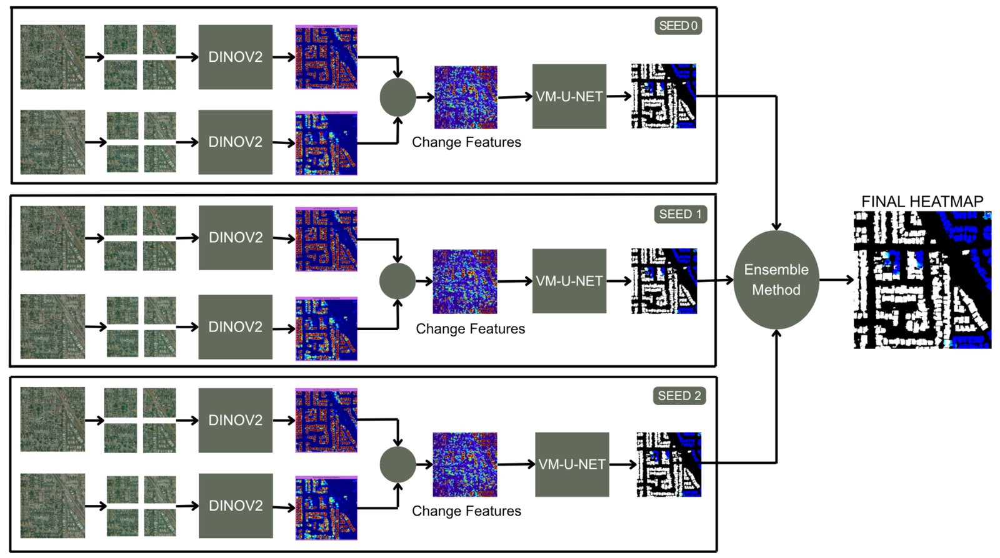
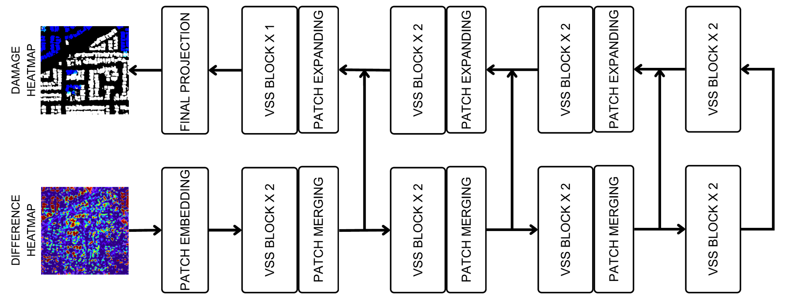
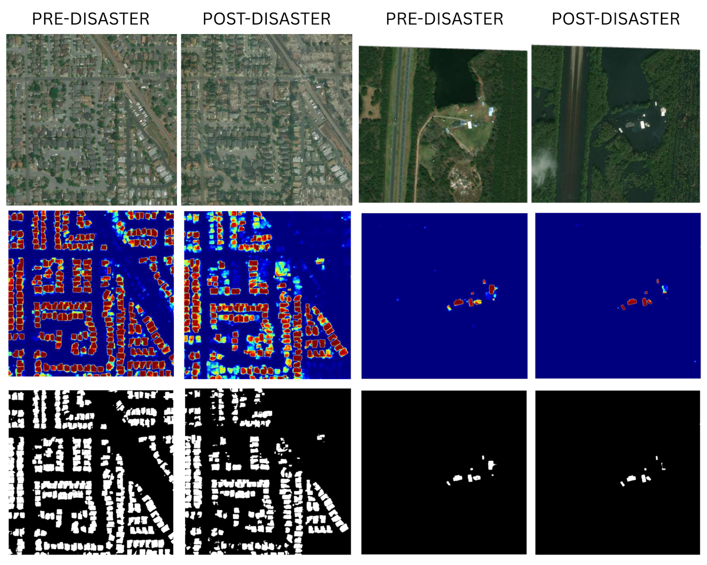
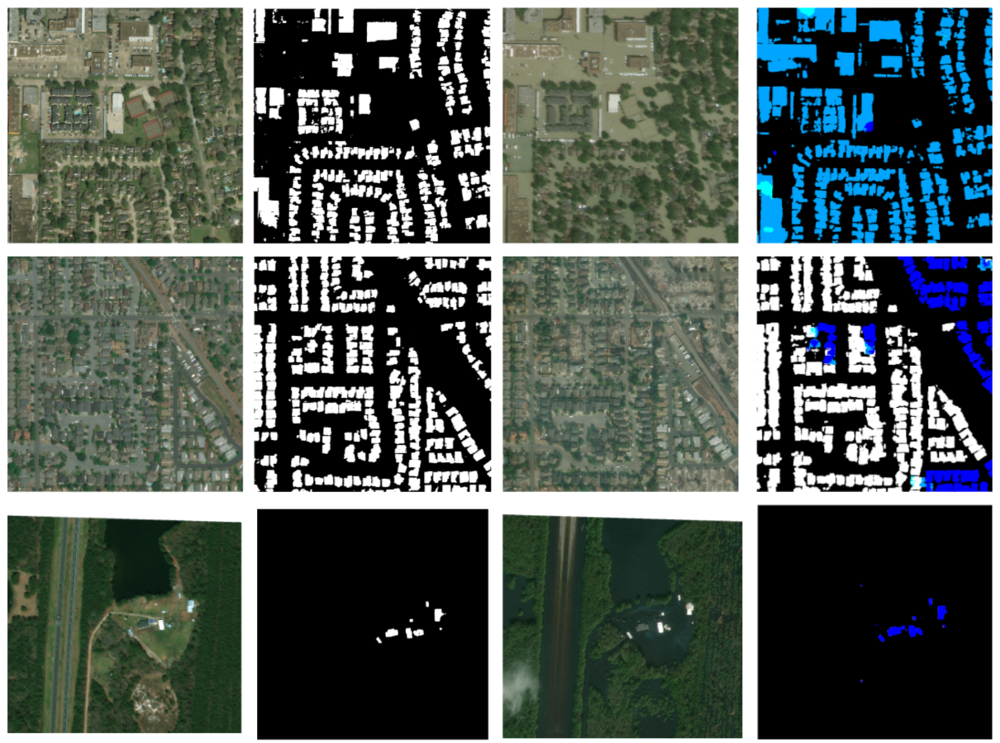

# GeoSense: Building Damage Assessment from Satellite Imagery

GeoSense detects buildings in satellite imagery and grades how badly each one was damaged by comparing images taken before and after a disaster. It combines a research model, described in a paper accepted for **oral presentation at the 6th International Conference on Computer Vision and Robotics (CVR 2026)**, with a web app that turns a pre/post image pair into a color-coded damage map.

> **Note:** The DINOv2-VM-UNet model from the paper is not yet included in this repository. The web app currently serves an SE-ResNeXt50 U-Net pipeline (see [Web app](#web-app)), and `backend/scripts/` contains the DINOv2-based training code used during development.

## Paper

**Hybrid Foundation-State Space Networks for Building Damage Assessment in Remote Sensing**
Piyush Deshmukh, Harsshita Vontivillu, Iris Soj, Divya Chirayil
Department of Information Technology, SIES Graduate School of Technology, Navi Mumbai

### The problem

Assessing damage from satellite imagery is hard for a few reasons. Damage cues such as debris, shifted roofs and cracks are subtle. Lighting, shadows and viewing angle differ between the two images. The images are large (usually 1024×1024). Most of all, the classes are severely imbalanced: background and undamaged buildings make up more than 95% of pixels, and destroyed buildings often less than 1%.

### Method: DINOv2-VM-UNet

<picture>
  <source media="(prefers-color-scheme: dark)" srcset="docs/images/pipeline-dark.png">
  
</picture>

*The full pipeline. Pre- and post-disaster images are split into patches and encoded by DINOv2, their features are subtracted to get change features, and VM-UNet decodes those into a damage map. Three models trained with different seeds are combined into the final heatmap.*

- **Encoder:** a self-supervised DINOv2 vision transformer extracts features from the pre- and post-disaster images separately. Change features come from subtracting the pre-disaster feature maps from the post-disaster ones.
- **Parameter-efficient fine-tuning:** most encoder weights stay frozen. LoRA on the attention layers and bottleneck adapters in the feed-forward blocks adapt the model from natural images to satellite imagery with few trainable parameters.
- **Decoder:** a VM-UNet built from Vision State Space (VSS) blocks. Its bidirectional selective state-space scanning models global context in linear time, compared with the quadratic cost of attention.
- **Multi-scale fusion:** the encoder's change features feed the decoder at several scales through skip connections.
- **Full-resolution inference:** images are split into overlapping patches (multiples of 14×14), and predictions in overlapping regions are averaged, so nothing is lost to resizing.
- **Handling imbalance:** geographic oversampling of damaged regions, plus dynamically weighted sampling and loss. Every three epochs, a script evaluates class-weight combinations (0.1–0.5× for background/no damage, 20–50× for minor, 100–200× for major/destroyed) and keeps the one with the best minority-class validation F1.
- **Training:** weighted Dice + Focal loss, AdamW with cosine annealing and warm restarts.
- **Ensemble:** three models trained with different random seeds are combined by majority vote.

<picture>
  <source media="(prefers-color-scheme: dark)" srcset="docs/images/decoder-dark.png">
  
</picture>

*The VM-UNet decoder. The difference heatmap passes through VSS blocks with patch merging on the way down and patch expanding on the way up, with skip connections between matching stages, before a final projection produces the damage heatmap.*

### Results on xBD

Using the standard xView2 metrics: localization F1 (building detection), classification F1 (damage grading), and the overall weighted F1.

| Method | Localization F1 | Classification F1 | Overall F1 |
|---|---|---|---|
| Siamese-UNet | 85.92 | 65.58 | 71.68 |
| ChangeOS-101-PPS | 86.69 | 75.44 | 78.52 |
| DamFormer-Tiny | 87.20 | 72.81 | 77.02 |
| MambaBDA-Base | 87.38 | 78.84 | 81.41 |
| **DINOv2-VM-UNet (ours)** | **87.32** | **77.10** | **80.16** |

DINOv2-VM-UNet outperforms the CNN-based methods and DamFormer-Tiny, and comes close to the best MambaBDA result. The full comparison is in the paper.

### Example predictions

<picture>
  <source media="(prefers-color-scheme: dark)" srcset="docs/images/building_footprints-dark.png">
  
</picture>

*Building localization on two scenes. Top: input images. Middle: predicted building probability. Bottom: binary building masks (white = building, black = background).*



*Damage assessment on three scenes. Each row shows the pre-disaster image, the predicted building footprints, the post-disaster image, and the predicted damage map (white = no damage, green = minor, light blue = major, dark blue = destroyed).*

### Ablation study

Each component's contribution to the overall weighted F1 (40 epochs, same training settings):

| Configuration | Overall F1 |
|---|---|
| Baseline (U-Net-style, pre/post difference input) | 0.26 |
| + DINOv2 encoder (frozen) | 0.56 |
| + VM-UNet decoder | 0.65 |
| + LoRA and bottleneck adapters | 0.68 |
| + Multi-scale fusion | 0.71 |
| + Geographic oversampling | 0.75 |
| + Dynamic weighted loss | 0.79 |
| + Three-seed ensemble | **0.80** |

Early training runs reached 94% pixel accuracy but only 0.18% IoU on the damaged classes, because the model learned to predict background everywhere. The imbalance handling steps above are what fixed that.

## Web app

Upload a pre-disaster and a post-disaster image of the same area, and the app returns:

- a damage heatmap with each building colored by severity: no damage, minor, major or destroyed
- the heatmap overlaid on the post-disaster image
- a building localization map
- the share of building pixels in each damage class
- a history of past analyses, with a download option for each heatmap

**How it works:** a localization model finds buildings in the pre-disaster image, and a classification model grades damage from the pre- and post-disaster images stacked together. Both are SE-ResNeXt50 U-Nets, with model definitions (`backend/zoo/`) adapted from the [xView2 Challenge first-place solution](https://github.com/vdurnov/xview2_1st_place_solution) (MIT license).

**Stack:** Flask and PyTorch backend; React, TypeScript, Vite, Tailwind CSS and shadcn/ui frontend.

### API

| Method | Endpoint | Description |
|---|---|---|
| GET | `/api/health` | Server status and whether models are loaded |
| POST | `/api/detect-damage` | Run an analysis. Form fields: `pre_image`, `post_image`, optional `threshold` (default 0.3) |
| GET | `/api/history` | List past analyses |
| GET | `/api/history/<id>` | Get one analysis |
| DELETE | `/api/history/<id>` | Delete an analysis and its files |
| GET | `/api/results/<id>/<file>` | Serve a result image |
| GET | `/api/download/<id>` | Download the damage heatmap |
| GET | `/api/model-info` | Model names, checkpoints and class colors |
| GET | `/api/config` | Supported formats and default settings |

## Running locally

### Backend

Requires Python 3 and, optionally, a CUDA GPU (it falls back to CPU).

```bash
cd backend
python -m venv venv
source venv/bin/activate        # Windows: venv\Scripts\activate
pip install -r requirements.txt
```

Create `backend/.env` and set `HF_MODEL_REPO` to the base URL the model weights are downloaded from. Then check the setup and start the server:

```bash
python setup_checker.py
python app.py                   # serves on http://localhost:5000 (set PORT to change)
```

The weights download into `backend/weights/` on first run.

### Frontend

```bash
cd frontend
npm install
npm run dev
```

The frontend expects the API at `http://localhost:5000`.

## Project structure

```
backend/
├── app.py                  Flask API: inference, heatmaps, statistics, history
├── utils.py                Image preprocessing
├── setup_checker.py        Verifies dependencies, CUDA and model weights
├── test_api.py             API smoke tests
├── zoo/                    SE-ResNeXt50 / DPN92 / SENet154 U-Net definitions
└── scripts/
    ├── geosense_model.py         Patch-based DINOv2 encoder and change-detection decoder
    ├── geosense_segformer.py     DINOv2 encoder with a SegFormer-style head
    ├── multiclass_training.py    Multi-class training loop and metrics
    ├── focal_loss.py             Focal + Dice loss and weighted sampler
    ├── adjust_class_wts.py       Class-weight search
    ├── analyze_class_iou.py      Per-class IoU analysis
    ├── xbd_dataset.py            xBD dataset loader
    ├── organize_dataset.py       Reorganizes the raw xBD download
    └── patch_processor.py        Overlapping patch extraction and merging
frontend/
└── src/pages/              Home, Upload, Progress, Results, About
docs/
└── images/                 Figures used in this README
```

## Dataset

[xBD](https://xview2.org/) (xView2): high-resolution pre- and post-disaster satellite image pairs covering 19 disasters, including hurricanes, floods, earthquakes, wildfires, tsunamis and volcanic eruptions. Pixels are labeled as background, no damage, minor damage, major damage or destroyed. The dataset is not included in this repository.

## Acknowledgements

- [xView2 first-place solution](https://github.com/vdurnov/xview2_1st_place_solution) for the U-Net model definitions used by the web app
- [DINOv2](https://github.com/facebookresearch/dinov2) (Meta AI)
- [VM-UNet](https://github.com/JCruan519/VM-UNet) (Ruan et al.)
- [xBD dataset](https://xview2.org/) (Gupta et al.)